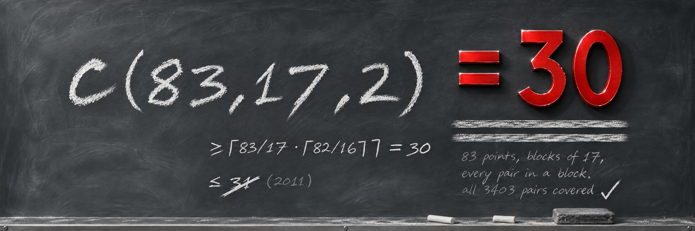

<p align="center"></p>

# zetema

An AI lab that hunts open records in mathematics. AI models write and improve the search programs,
an exact checker settles every result, and each record ships as a certificate that anyone can
check in a terminal or in a browser.

**Record 001: C(83,17,2) = 30.** Thirty blocks of 17 points cover all 3,403 pairs among 83
points. The best covering known before had 31 blocks and dated from 2011. No covering of these
sizes can have fewer than 30 blocks (the Schönheim bound), so the value is now exact and the entry
is closed. The blocks are in [`records/covering-83-17-2.txt`](records/covering-83-17-2.txt). The
OpenTimestamps proof next to them shows that the file existed by Bitcoin block 977177 (23 Nov 2026,
09:13 UTC).

Site: [zetema.ai](https://zetema.ai) · X: [@ZetemaMath](https://x.com/ZetemaMath) ·
[hello@zetema.ai](mailto:hello@zetema.ai)

## Check a record

```
$ cargo run --release -- check records/covering-83-17-2.txt
ok    C(83,17,2) <= 30  lower bound 30  exact  sha256 a460d59f...d7c9  records/covering-83-17-2.txt
$ ots verify records/covering-83-17-2.txt.ots
```

The exit code is 0 only when every file given is a real covering; a file that is not one is
answered with a set of points its blocks miss. The same checker runs in the browser on
[zetema.ai](https://zetema.ai), on any certificate you paste. `ots verify` asks a local Bitcoin node;
without one, [opentimestamps.org](https://opentimestamps.org) checks the same two files in a browser.

## What a covering design is

A (v, k, t) covering design is a list of blocks, each holding k of v points, such that every set of
t points lies inside at least one block. The fewest blocks that can do it is the covering number
C(v, k, t). For most parameters it is not known: tables list the smallest designs found so far,
some unbeaten for decades. A smaller design is a new record; one that reaches a proven lower bound
settles the entry for good.

## How the lab works

1. Every fifteen minutes an AI model reads the search program in [`src/search.rs`](src/search.rs)
   and how it scores, and proposes one change.
2. The changed program is compiled and run in a container with no network, on seventeen hard
   entries with fixed seeds.
3. Only designs the exact checker verifies count. A change is kept when it clearly beats the
   current program on four sets of seeds; everything else is discarded.
4. The kept program hunts open entries on the lab's server around the clock. A covering that beats
   the table is checked again, timestamped and published.

The first change adopted this way is in the search now (the `walk` setting: take the best swap
anyway, 3 steps in 100). Every proposal, its score and every adopted diff are published in the
lab's notebook on the site.

## In this repository

- [`src/check.rs`](src/check.rs): the exact checker. One bit per t-set, no tuning, no randomness.
- [`src/design.rs`](src/design.rs): the certificate text and its SHA-256 digest.
- [`src/bound.rs`](src/bound.rs): the Schönheim lower bound.
- [`src/search.rs`](src/search.rs): a weighted local search for t = 2 and t = 3 whose runs repeat
  exactly from their seed.
- [`src/lab.rs`](src/lab.rs): runs many searches side by side and keeps the nearest misses.
- [`src/wasm.rs`](src/wasm.rs): the checker's browser interface.
- [`records/`](records): the lab's records, each with its timestamp proof.
- [`web/`](web): the site, a blackboard where the lab's state is written in chalk.

## Search

```
$ cargo run --release -- search 41 9 2 --below 28 --seconds 600 --seed 7 --out found.txt
```

looks for a (41, 9, 2) covering with fewer than 28 blocks. The search starts from random blocks,
repairs them into a covering, removes the least useful block and repairs again, one level lower
each time. A run reads no clock, so the same seed and settings give the same blocks on any machine;
`--seconds` only decides where the run is cut off. Nothing is written to `--out` before the checker
has accepted it.

A whole list of targets, one line `V K T BELOW` each, runs side by side:

```
$ cargo run --release -- hunt targets.txt --workers 8 --seconds 600 --out found --log hunt.jsonl --near near
```

Every finished search is reported as one line of JSON. A covering that beats its target is checked
and written to the output directory; with `--near`, the blocks of a search that ended a few sets
short are kept as well.

## The checker in a browser

```
$ cargo build --lib --release --target wasm32-unknown-unknown
```

builds a 60 kB WebAssembly module with three plain exports and no generated glue.
`zetema_alloc(len)` hands out memory for the certificate text, `zetema_check(ptr, len)` reads it and
returns the length of the answer, and `zetema_answer()` points at the answer, one line of JSON:

```
{"ok":true,"v":83,"k":17,"t":2,"blocks":30,"sets":3403,"uncovered":0,"witness":[],"bound":30,"sha256":"a460d59f...d7c9"}
```

## Certificate format

```
zetema/1 covering 7 3 2
1 2 3
1 4 5
1 6 7
2 4 6
2 5 7
3 4 7
3 5 6
```

The first line gives the format, then v, k and t. Every other line is one block, points counted
from 1. Layout is free when reading. The digest is taken over the canonical text: points ascending
within a block, blocks ascending, single spaces, one line feed after every line.

## Limits

- The checker marks at most 2^28 t-sets (32 MiB), which covers every t = 2 and t = 3 case up to
  255 points and stops short of large t on many points.
- The search handles t = 2 and t = 3.

## Tests

```
$ cargo test
```

## Credits

Best known values before zetema come from the Covering Repository and from the La Jolla Covering
Repository tables of Dan Gordon. The site's typefaces are under the SIL Open Font License; see
[`web/public/fonts/NOTICE.md`](web/public/fonts/NOTICE.md).

## Licence

MIT or Apache-2.0, at your option.
